# Capturas de pantalla

| Ajustes | Login |
| :---: | :---: |
| 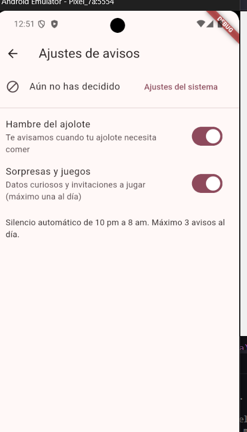 | 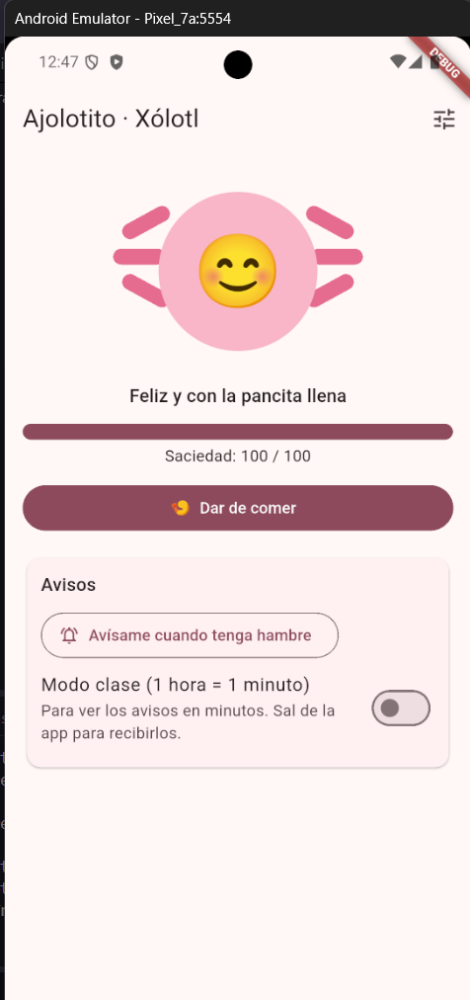 |

| Xolotl comiendo | Xolotl hambre |
| :---: | :---: |
| 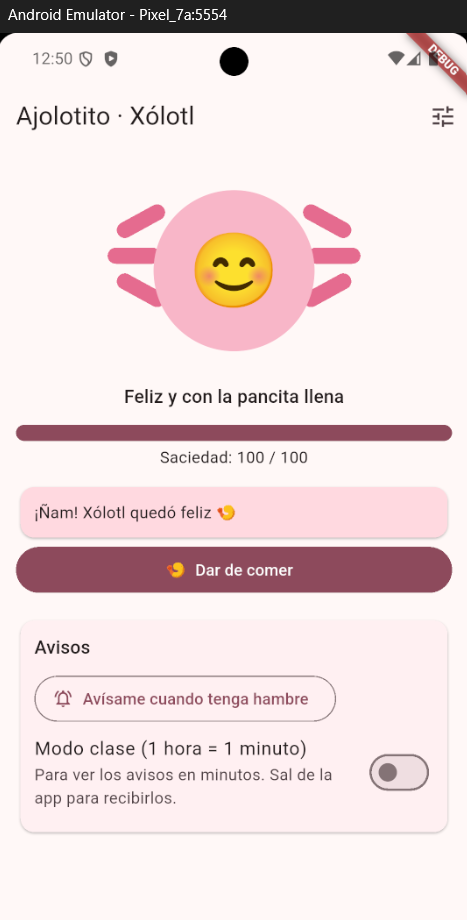 | 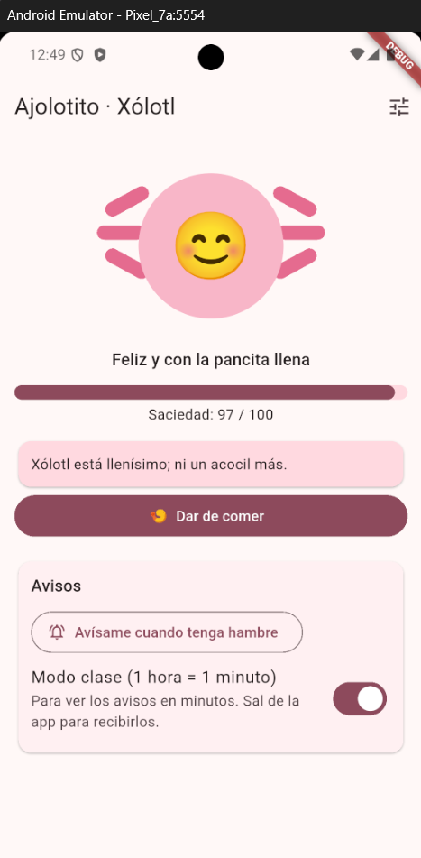 |

| Lleno xolotl | Pruebas generales |
| :---: | :---: |
| 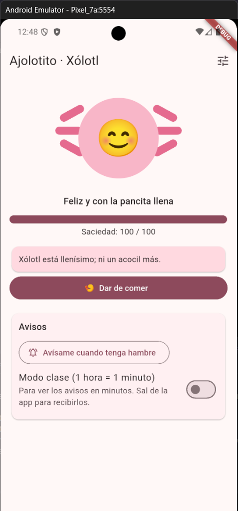 | 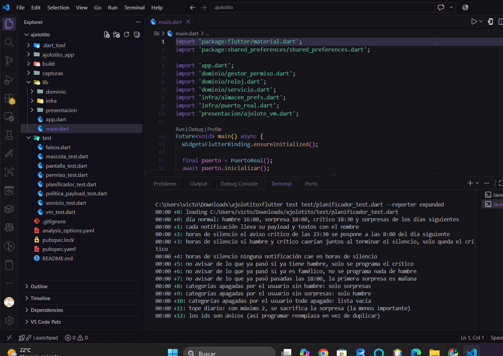 |

| Test | Test pantalla |
| :---: | :---: |
| 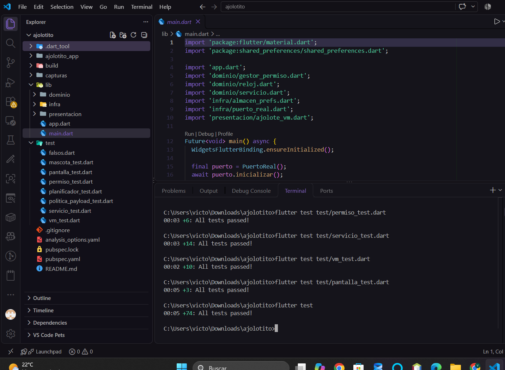 | 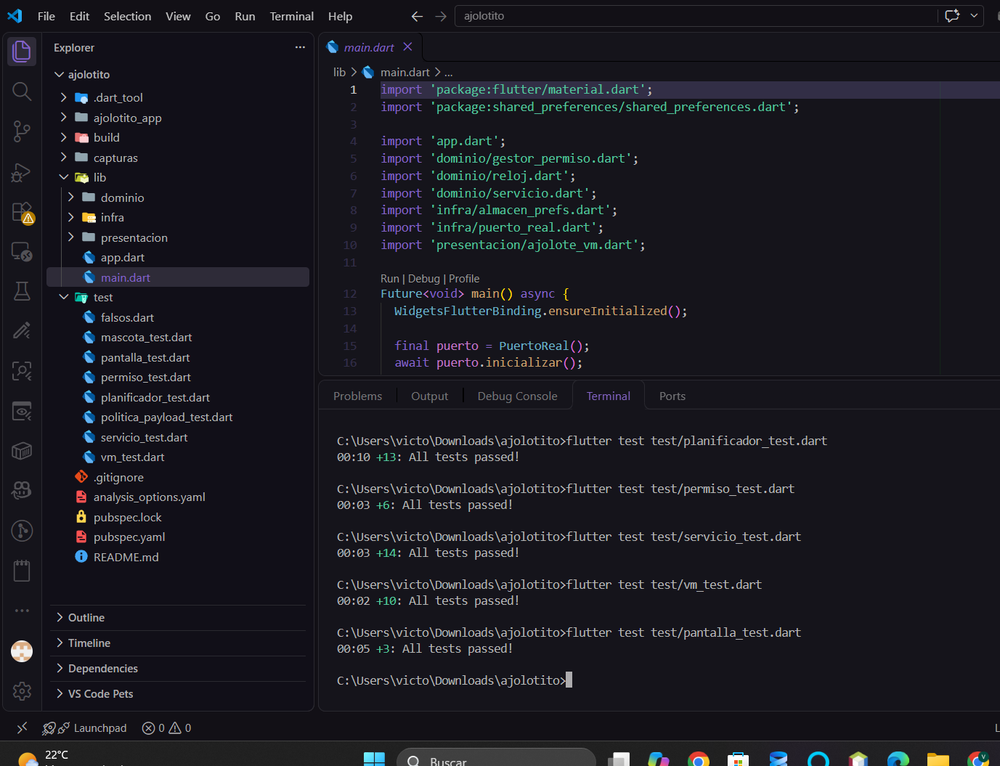 |

| Test VM | Test servicio |
| :---: | :---: |
| 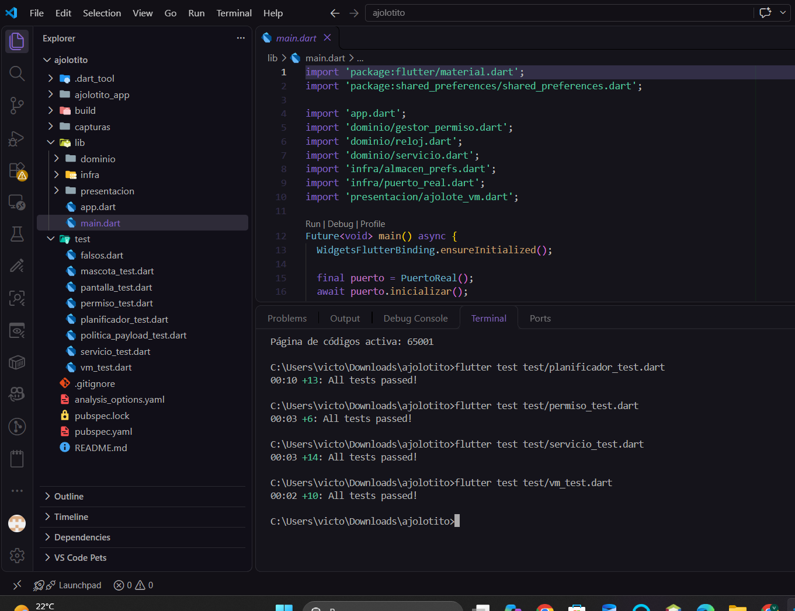 | 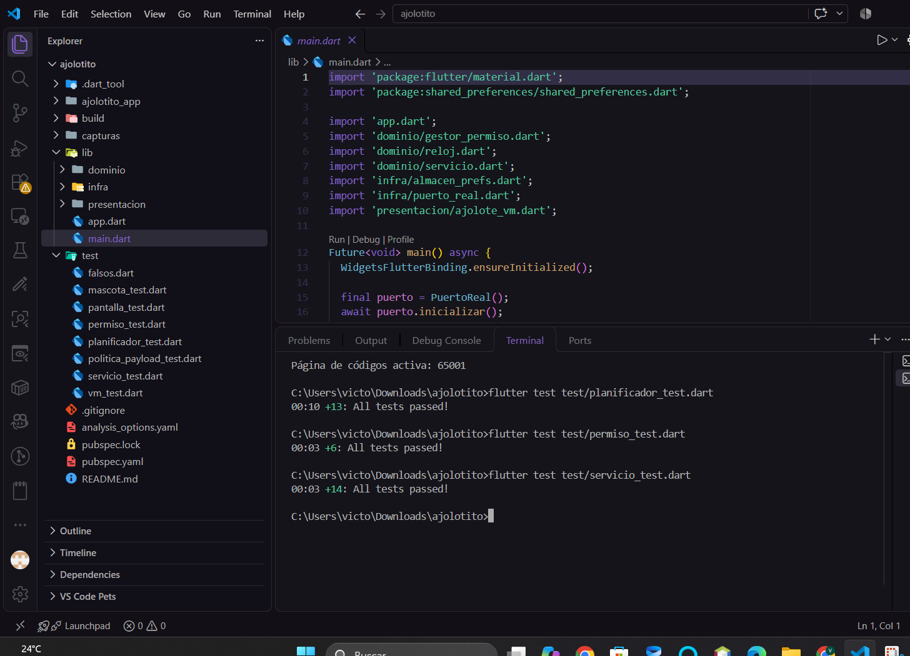 |

| Test permiso | Test planificador |
| :---: | :---: |
| 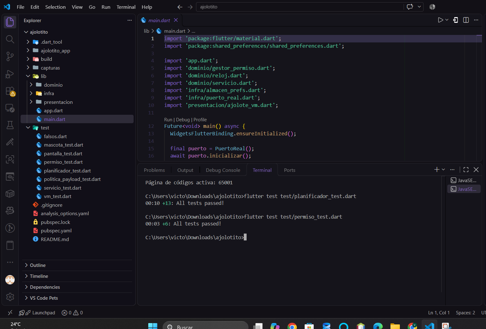 | 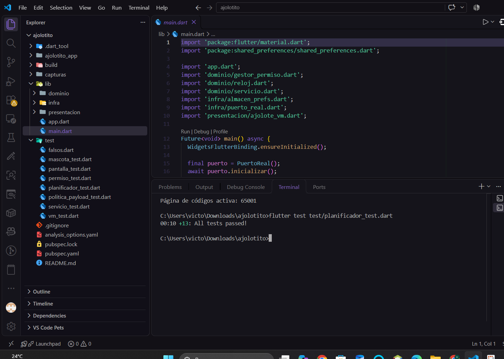 |

| Test política | Test mascota |
| :---: | :---: |
| 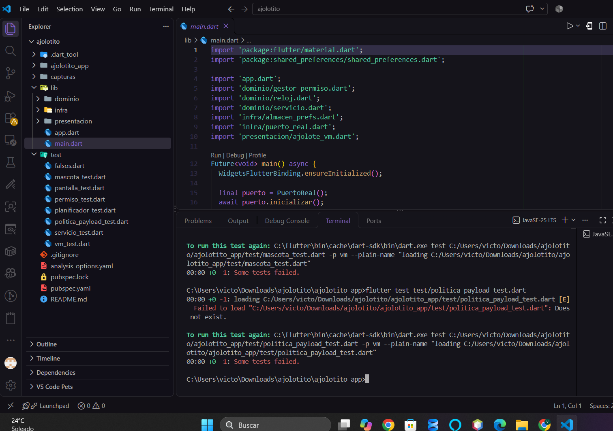 | 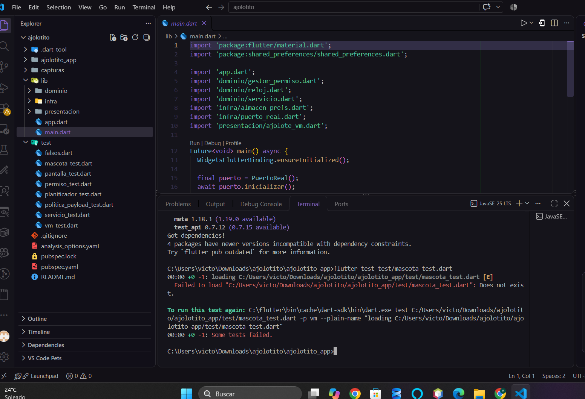 |

## Ejecución local

1. Clona el repositorio:
   ```bash
   git clone [https://github.com/vic0307/](https://github.com/vic0307/)<NOMBRE_DE_TU_REPO>.git
